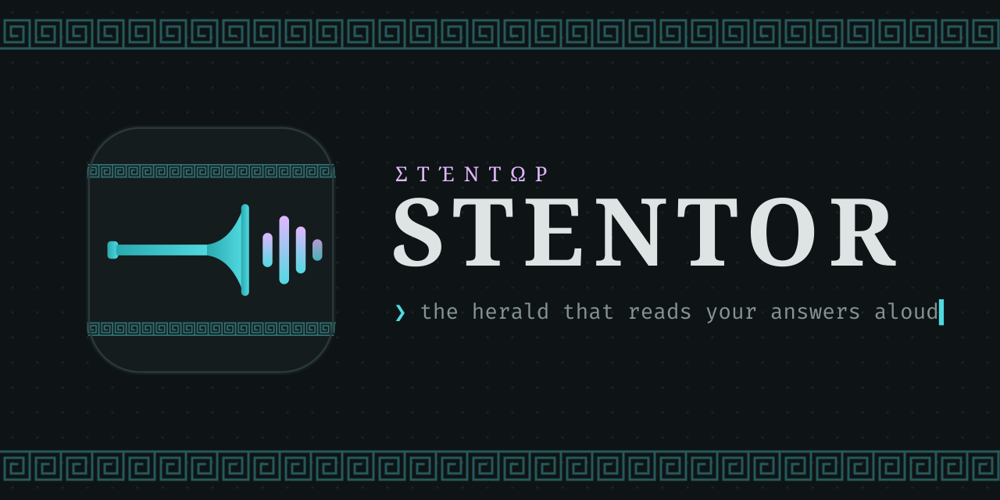

<p align="center">
  
</p>

<p align="center">
  <a href="#instalación">Instalación</a> ·
  <a href="#teclas">Teclas</a> ·
  <a href="#configuración">Configuración</a> ·
  <a href="#sistemas">Sistemas</a> ·
  <a href="#problemas-frecuentes">Problemas frecuentes</a> ·
  <a href="README.md">English</a>
</p>

**Stentor** es un plugin para [Claude Code](https://code.claude.com) que lee en voz alta las
respuestas de Claude. La voz es [Kokoro](https://github.com/thewh1teagle/kokoro-onnx), un modelo
gratuito que funciona en tu propia computadora: sin cuenta, sin clave de API, sin costo por respuesta,
y nada de lo que escuchas sale de tu máquina.

> En la *Ilíada*, Stentor es el heraldo griego cuya voz sonaba como la de cincuenta hombres juntos.
> Este es más discreto: lee tus respuestas para que puedas apartar la vista de la pantalla.

## Instalación

Necesitas un Claude Code reciente (probado con 2.1.332) y Python 3.10 a 3.14.

1. **Agrega el plugin.** En Claude Code:

   ```
   /plugin install stentor --marketplace Arielc17/stentor
   ```

   En versiones anteriores a 2.1.275, agrega primero el marketplace:

   ```
   /plugin marketplace add Arielc17/stentor
   /plugin install stentor@stentor
   ```

2. **Instala las voces** (una sola vez, unos 120 MB). Escribe `/stentor:install`. El avance se ve
   debajo del cuadro de texto (*Stentor: descargando voces (1 de 2)… 60%*) mientras sigues trabajando.

3. **Escucha.** Cuando diga *Voces instaladas: presiona 1 para escuchar*, presiona `1`.

El instalador crea un entorno de Python privado, instala `kokoro-onnx` y descarga los dos archivos
del modelo, comprobando su SHA-256. Si lo vuelves a ejecutar, repara lo que falte.

También puedes ejecutarlo en una terminal, por ejemplo si `/stentor:install` no logra terminar (su
mensaje muestra entonces la línea exacta):

```
python3 "<carpeta del plugin>/scripts/install.py"      # Linux y macOS
py -3 "<carpeta del plugin>\scripts\install.py"        # Windows
```

## Teclas

Encima del cuadro de texto aparece una fila con tres teclas:

| Tecla | Acción |
| --- | --- |
| `1` | Lee la respuesta que estás viendo: la última si estás abajo del todo, o la que ocupa más pantalla si subiste. |
| `2` | Detiene la lectura. |
| `3` | Cambia a la siguiente voz. |

Al pasar el mouse sobre una respuesta aparece **▶ Escuchar** en su esquina: haz clic para oír justo esa.

Los bloques de código, las tablas, los enlaces y las rutas largas se omiten para que la lectura suene
natural. En Linux, la música y los videos se pausan mientras Stentor lee y se reanudan al terminar
(mediante MPRIS).

## Configuración

Abre `/plugin`, elige Stentor y cambia:

| Opción | Valor inicial | Qué hace |
| --- | --- | --- |
| **Voices** | `em_alex,ef_dora` | Las voces de Kokoro que recorre la tecla `3`, separadas por comas. |
| **Speed** | `1` | Velocidad, de `0.5` a `2.0`. |

La primera letra de cada voz indica su idioma (`e` español, `a` inglés de EE. UU., `b` inglés
británico, `f` francés, `i` italiano, `p` portugués, `h` hindi, `j` japonés, `z` chino), y las
etiquetas de las teclas siguen el idioma de la primera voz. Todas las voces están en la
[lista de voces de Kokoro](https://huggingface.co/hexgrad/Kokoro-82M/blob/main/VOICES.md).

## Sistemas

| Sistema | Estado |
| --- | --- |
| Linux (PipeWire, PulseAudio o ALSA) | ✅ Probado |
| macOS | 🟡 Debería funcionar, aún sin probar |
| Windows | 🟡 Debería funcionar, aún sin probar |

Si lo pruebas en macOS o Windows, [cuéntanos cómo te fue](https://github.com/Arielc17/stentor/issues/new/choose),
haya funcionado o no.

- **Linux:** el audio sale por `pw-play`, `paplay` o `aplay`, el que esté instalado. Si no hay
  ninguno, el instalador agrega `sounddevice`, que necesita PortAudio
  (`sudo apt install libportaudio2` en Debian y Ubuntu).
- **macOS y Windows:** el audio sale por `sounddevice`, que agrega el instalador.
- **Windows:** usa el Python de [python.org](https://www.python.org/downloads/), no el de Microsoft Store.
- Elegir la respuesta en pantalla con la tecla `1` necesita el diseño de pantalla completa de
  Claude Code. En los demás, la tecla `1` lee la última respuesta.

## Problemas frecuentes

| Lo que ves | Qué hacer |
| --- | --- |
| *Falta instalar las voces: escribe /stentor:install* | Escribe `/stentor:install` y espera a que diga *Voces instaladas*. |
| *No se pudieron instalar las voces: …* | El resto del mensaje dice por qué. Corrígelo y vuelve a escribir `/stentor:install`. |
| *Stentor necesita Python 3.10 o más nuevo* | Instala Python desde [python.org](https://www.python.org/downloads/) y vuelve a escribir `/stentor:install`. |
| *La voz … no existe* | Revisa que la opción **Voices** esté bien escrita. |
| *… no es una carpeta privada tuya* | La carpeta de estado es de otro usuario o es un enlace: bórrala o define `STENTOR_STATE`. |
| En macOS una descarga falla con `CERTIFICATE_VERIFY_FAILED` | Ejecuta `Install Certificates.command` de la carpeta de Python en Aplicaciones y vuelve a correr el instalador. |
| *Could not create the Python environment* | En Debian o Ubuntu: `sudo apt install python3-venv` y vuelve a correr el instalador. |
| No suena nada | Mira `reader.log` en la carpeta de estado (abajo). |

## Dónde se guarda cada cosa

| Qué | Dónde | Se cambia con |
| --- | --- | --- |
| Voces y entorno de Python | `~/.local/share/stentor` (`$XDG_DATA_HOME/stentor` si está definido) · `%LOCALAPPDATA%\stentor` en Windows | `STENTOR_DATA` |
| Lectura actual, respuestas guardadas, `reader.log` | `$XDG_RUNTIME_DIR/stentor`, o una carpeta `stentor-<usuario>` en la carpeta temporal del sistema | `STENTOR_STATE` |

**Privacidad.** Para leer una respuesta, Stentor guarda su texto en la carpeta de estado, que solo
tu usuario puede abrir. Las respuestas guardadas se borran a la semana. Lo único que se descarga son
los paquetes de Python y los dos archivos del modelo desde las
[releases de kokoro-onnx](https://github.com/thewh1teagle/kokoro-onnx/releases/tag/model-files-v1.0).

**Desinstalar.** Quita el plugin con `/plugin` y borra la carpeta de datos.

## Créditos

- [Kokoro-82M](https://huggingface.co/hexgrad/Kokoro-82M) de hexgrad, Apache-2.0.
- [kokoro-onnx](https://github.com/thewh1teagle/kokoro-onnx) de thewh1teagle, MIT.

Stentor tiene licencia MIT. Es un proyecto independiente de la comunidad, sin relación con
Anthropic ni respaldado por Anthropic. Claude y Claude Code son marcas de Anthropic.
