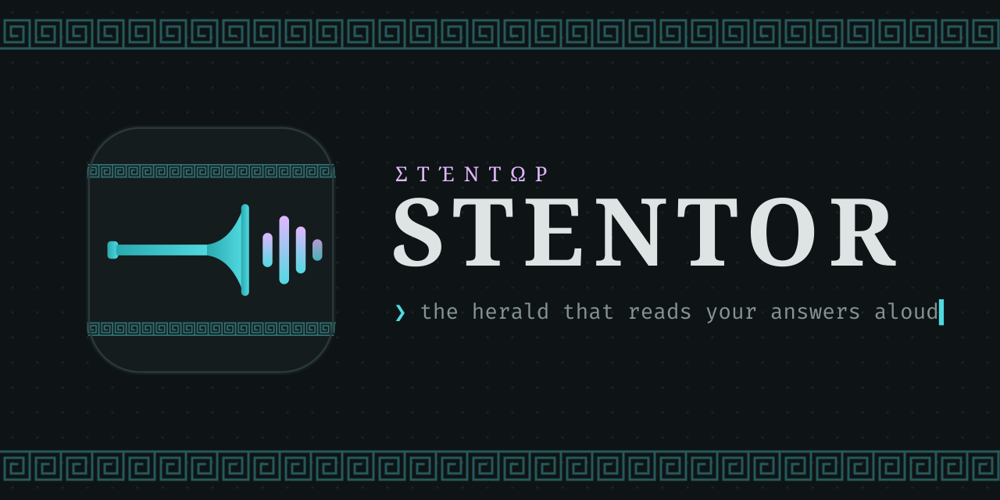

<p align="center">
  
</p>

<p align="center">
  <a href="https://code.claude.com/docs/en/plugins"></a>
  <a href="LICENSE"></a>
  
  
</p>

<p align="center">
  <a href="#install">Install</a> ·
  <a href="#keys">Keys</a> ·
  <a href="#settings">Settings</a> ·
  <a href="#platforms">Platforms</a> ·
  <a href="#troubleshooting">Troubleshooting</a> ·
  <a href="README.es.md">Español</a>
</p>

**Stentor** is a plugin for [Claude Code](https://code.claude.com) that reads Claude's answers aloud.
The voice is [Kokoro](https://github.com/thewh1teagle/kokoro-onnx), a free model that runs on your
own computer: no account, no API key, no cost per answer, and nothing you hear leaves your machine.

> In the *Iliad*, Stentor is the Greek herald whose voice was as loud as fifty men together.
> This one is quieter, and reads your answers so you can look away from the screen.

## Install

You need a recent Claude Code (tested with 2.1.332) and Python 3.10 to 3.14.

1. **Add the plugin.** In Claude Code:

   ```
   /plugin install stentor --marketplace Arielc17/stentor
   ```

   On versions before 2.1.275, add the marketplace first:

   ```
   /plugin marketplace add Arielc17/stentor
   /plugin install stentor@stentor
   ```

2. **Install the voices** (once, about 120 MB). Type `/stentor:install` and run the line it prints
   in a terminal. It looks like this:

   ```
   python3 "<plugin folder>/scripts/install.py"      # Linux and macOS
   py -3 "<plugin folder>\scripts\install.py"        # Windows
   ```

3. **Listen.** Restart Claude Code (or run `/reload-plugins`) and press `1`.

The installer creates a private Python environment, installs `kokoro-onnx`, and downloads the two
model files, checking their SHA-256. Running it again repairs whatever is missing.

## Keys

A row above the prompt gives you three keys:

| Key | Action |
| --- | --- |
| `1` | Read the answer you are looking at: the newest one at the bottom, or the one that fills most of the screen when you scroll up. |
| `2` | Stop reading. |
| `3` | Switch to the next voice. |

Hover over any answer and a **▶ Listen** mark (**▶ Escuchar** with Spanish voices) appears in its
corner: click it to hear that answer.

Code blocks, tables, links and long paths are skipped so the reading sounds natural. On Linux,
music and video players are paused while Stentor reads and resumed afterwards (through MPRIS).

## Settings

Open `/plugin`, pick Stentor and change:

| Setting | Default | What it does |
| --- | --- | --- |
| **Voices** | `em_alex,ef_dora` | The Kokoro voices that key `3` cycles through, comma-separated. |
| **Speed** | `1` | From `0.5` to `2.0`. |

The first letter of a voice sets its language, and the keys' labels follow the first voice:

| Letter | Language | Example |
| --- | --- | --- |
| `a` | US English | `af_heart,am_michael` |
| `b` | British English | `bf_emma,bm_george` |
| `e` | Spanish | `em_alex,ef_dora` |
| `f` · `i` · `p` | French · Italian · Portuguese | `ff_siwis`, `if_sara`, `pf_dora` |
| `h` · `j` · `z` | Hindi · Japanese · Chinese | `hf_alpha`, `jf_alpha`, `zf_xiaobei` |

All voices are in the [Kokoro voice list](https://huggingface.co/hexgrad/Kokoro-82M/blob/main/VOICES.md).

## Platforms

| System | Status |
| --- | --- |
| Linux (PipeWire, PulseAudio or ALSA) | ✅ Tested |
| macOS | 🟡 Should work, not tested yet |
| Windows | 🟡 Should work, not tested yet |

If you try it on macOS or Windows, please [tell us how it went](https://github.com/Arielc17/stentor/issues/new/choose),
whether it worked or not.

- **Linux:** audio goes through `pw-play`, `paplay` or `aplay`, whichever is installed. Without
  any of them the installer adds `sounddevice`, which needs PortAudio
  (`sudo apt install libportaudio2` on Debian and Ubuntu).
- **macOS and Windows:** audio goes through `sounddevice`, which the installer adds.
- **Windows:** use Python from [python.org](https://www.python.org/downloads/), not the Microsoft
  Store one.
- Choosing the answer on screen with key `1` needs Claude Code's fullscreen layout. In other layouts
  key `1` reads the newest answer.

## Troubleshooting

| What you see | What to do |
| --- | --- |
| *Voices not installed yet: type /stentor:install* | Run the line that `/stentor:install` prints, then `/reload-plugins`. |
| *There is no voice named …* | Check the **Voices** setting for a typo. |
| *… is not a private folder of yours* | Another user or a link owns the state folder: remove it or set `STENTOR_STATE`. |
| A download fails on macOS with `CERTIFICATE_VERIFY_FAILED` | Run `Install Certificates.command` from the Python folder in Applications, then the installer again. |
| *Could not create the Python environment* | On Debian or Ubuntu: `sudo apt install python3-venv`, then the installer again. |
| Nothing sounds | Look at `reader.log` in the state folder (below). |

## Where things live

| What | Where | Change it with |
| --- | --- | --- |
| Voices and Python environment | `~/.local/share/stentor` (`$XDG_DATA_HOME/stentor` if set) · `%LOCALAPPDATA%\stentor` on Windows | `STENTOR_DATA` |
| Current reading, saved answers, `reader.log` | `$XDG_RUNTIME_DIR/stentor`, or a `stentor-<user>` folder in the system temp folder | `STENTOR_STATE` |

**Privacy.** To read an answer, Stentor saves its text in the state folder, which only your user can
open. Saved answers are deleted after a week. The only downloads are the Python packages and the two
model files from the [kokoro-onnx releases](https://github.com/thewh1teagle/kokoro-onnx/releases/tag/model-files-v1.0).

**Uninstall.** Remove the plugin with `/plugin` and delete the data folder.

## Contributing

Bug reports, tests on macOS and Windows, and pull requests are welcome. See
[CONTRIBUTING.md](CONTRIBUTING.md) for how to run the tests.

## Credits

- [Kokoro-82M](https://huggingface.co/hexgrad/Kokoro-82M) by hexgrad, Apache-2.0.
- [kokoro-onnx](https://github.com/thewh1teagle/kokoro-onnx) by thewh1teagle, MIT.

Stentor is MIT licensed. It is an independent community project, not affiliated with or endorsed
by Anthropic. Claude and Claude Code are trademarks of Anthropic.
